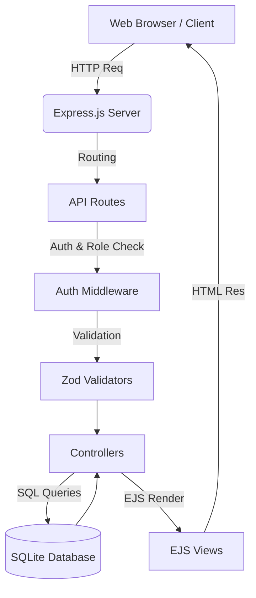

# CareTrack Clinic MRMS (Medical Record Management System)

A comprehensive, production-ready, full-stack clinic management system built with Node.js, Express, TypeScript, EJS, and SQLite.

---

## 🌟 Key Features

*   **Modular Architecture**: Clean code structure dividing routes, controllers, middlewares, validators, and database config.
*   **RBAC (Role-Based Access Control)**: Secure access tailored for Admin, Clinician, and Receptionist roles.
*   **Appointment Engine**: Comprehensive CRUD operations for managing patient appointments.
*   **Patient & Doctor Management**: Maintain detailed records and assignment of patients to specific clinicians.
*   **Medical Records (Illnesses)**: Keep track of diagnoses, prescribed medications, status, and historical data.
*   **Strict Validation**: Input validation and sanitization using Zod.
*   **DevOps Ready**: Pre-configured with Docker, Docker Compose, and a GitHub Actions CI pipeline.
*   **Secure API**: Implementations of Helmet, Express Rate Limit, and strict session management.
*   **Comprehensive Testing**: Unit and Integration test coverage powered by Jest and Supertest.

---

## 🏗️ System Architecture

---

## 🗄️ Entity-Relationship (ER) Model

*   **Users**: Manages application access (Admin, Clinician, Receptionist).
*   **Doctors**: Stores physician details and links to their patients and appointments.
*   **Patients**: Stores patient demographics and assigns them a primary doctor.
*   **Illnesses**: Medical records tracking diagnoses, tied to a Patient and Doctor.
*   **Appointments**: Scheduling records linking a Patient to a Doctor at a specific date/time.

*Relations:*
*   1 Doctor -> N Patients
*   1 Patient -> N Illnesses
*   1 Doctor -> N Illnesses
*   1 Patient -> N Appointments
*   1 Doctor -> N Appointments

---

## 🔌 REST API Specification

| Entity | Method | Endpoint | Description | Roles Allowed |
| :--- | :--- | :--- | :--- | :--- |
| **Auth** | GET/POST | `/login`, `/logout` | Authentication and Session management | All |
| **Dashboard** | GET | `/dashboard` | View metrics, workload, and charts | All logged in |
| **Patients** | GET | `/patients` | List all patients | All logged in |
| | GET/POST | `/patients/create` | Register new patient | All logged in |
| | GET/POST | `/patients/:id/edit` | Edit patient details | Admin, Clinician |
| | POST | `/patients/:id/delete`| Delete a patient | Admin |
| **Appointments**| GET | `/appointments` | List all appointments | All logged in |
| | GET/POST | `/appointments/create`| Schedule new appointment | Admin, Receptionist|
| | GET/POST | `/appointments/:id/edit`| Update appointment status/time| Admin, Receptionist|
| | POST | `/appointments/:id/delete`| Cancel/Delete appointment | Admin |
| **Illnesses** | GET | `/illnesses` | List medical records | All logged in |
| | GET/POST | `/illnesses/create` | Add new diagnosis | Admin, Clinician |
| | GET/POST | `/illnesses/:id/edit` | Update diagnosis | Admin, Clinician |
| | POST | `/illnesses/:id/delete` | Delete diagnosis record | Admin |
| **Doctors** | GET | `/doctors` | List all doctors | All logged in |
| | GET/POST | `/doctors/create` | Add new doctor | Admin |
| | GET/POST | `/doctors/:id/edit` | Update doctor info | Admin |
| | POST | `/doctors/:id/delete` | Remove doctor | Admin |
| **Users** | GET | `/users` | List system users | Admin |
| | GET/POST | `/users/create` | Add new system user | Admin |
| | GET/POST | `/users/:id/edit` | Update user roles/passwords | Admin |
| | POST | `/users/:id/delete` | Remove user (except self) | Admin |

---

## 🔒 Security & HIPAA/GDPR Considerations

When deploying this software in a real-world healthcare environment, consider the following standards:

1.  **Data at Rest**: SQLite database file should be placed on an encrypted volume (e.g., LUKS, BitLocker).
2.  **Data in Transit**: Ensure the server is placed behind a Reverse Proxy (Nginx/Apache) with forced HTTPS/TLS 1.2+ configuration.
3.  **Role-Based Access Control (RBAC)**: Implemented strict middleware ensuring clinicians only perform medical actions, receptionists manage scheduling, and admins handle system settings.
4.  **Input Sanitization**: Utilization of `Zod` blocks NoSQL/SQL Injection by enforcing strict type parsing and regex matching on user inputs.
5.  **Secure Sessions**: `express-session` is configured. In production, consider backing sessions with Redis and enabling the `secure: true` cookie flag.
6.  **Audit Logs**: Consider implementing detailed application-level logging for all CRUD actions on patient data (Who accessed What and When).

---

## 🚀 Setup & Installation Guide

### Prerequisites
*   Node.js (v18+)
*   Docker (Optional, but recommended for production)

### Local Development (Without Docker)

1. **Clone the repository and install dependencies:**
   `npm install`

2. **Environment Variables:**
   Create a `.env` file from the example:
   `cp .env.example .env`

3. **Database Seeding:**
   Seed the database with sample users and records:
   `npm run seed`

4. **Run the Server:**
   `npm run dev &`
   *The server will start on http://localhost:3001.*

### Docker Deployment

To spin up the service in an isolated Docker container with persistent database storage:

`docker-compose up -d`
*The database file will be safely persisted in the Docker volume `sqlite_data`.*

### Testing

Run the comprehensive unit and integration test suite:

`npm test`

---

## 🔑 Default Seed Logins

If you run `npm run seed`, use the following credentials to access the system:

*   **Admin**: `admin` / `admin123`
*   **Clinician (Doctor)**: `doctor1` / `doctor123`
*   **Receptionist**: `reception1` / `recep123`

---
